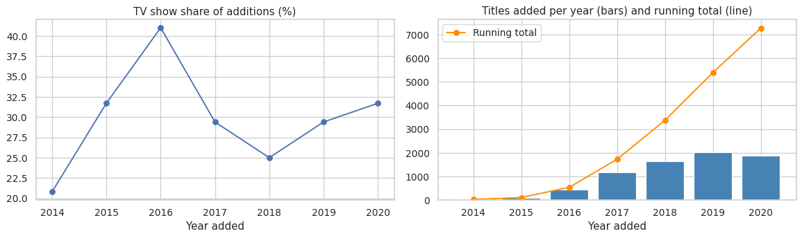
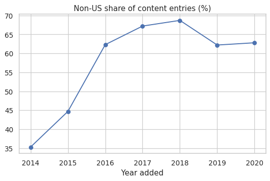
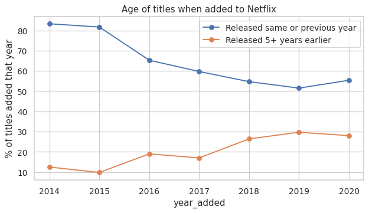
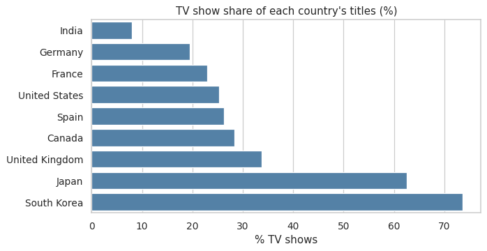

# Netflix Content Strategy Analysis

**Python + SQL analysis of how Netflix's catalog changed between 2014 and 2020, and where its growth came from.**

Built with pandas, SQLite (SQL), matplotlib and seaborn on 8,807 titles.

---

## Business question

How has Netflix's content strategy changed over time? Specifically:

- Is Netflix shifting from movies to TV shows?
- Is the catalog becoming more international?
- Is growth coming from new releases or older library titles?
- Do different countries specialize in different formats and genres?

---

## Key findings

| # | Finding | Evidence |
|---|---------|----------|
| 1 | **Growth came with older content.** The share of additions released 5+ years earlier tripled. | 9.8% (2015) to 29.7% (2019). Yearly additions grew from 82 to 2,016. |
| 2 | **Internationalization happened early, then levelled off.** | Non-US share of entries: 35.3% (2014), 68.7% (2018), about 62-63% in 2019-2020. India has ranked second behind the US every year since 2017. |
| 3 | **India's catalog is almost all movies.** | Only 8.0% of India's titles are TV shows, versus 62.5% for Japan and 73.6% for South Korea. |
| 4 | **There is no steady shift from movies to TV.** | TV share: 41.0% (2016), 25.0% (2018), 31.7% (2020). TV additions grew 44% from 2018 to 2020; movie additions grew 4%. |
| 5 | **Seasonality is weak.** | October and December average about 10.2% of yearly additions (8.3% if spread evenly), and the busiest month changes every year. |

**Recommendation:** India is a top non-US source of content, but only 8.0% of its titles are TV shows, while TV dominates the Korean and Japanese catalogs. A content-acquisition team should investigate Indian TV series as the biggest gap in the international catalog, for example by comparing viewing of existing Indian series with Indian movies.

---

## Charts









---

## Approach

| Step | Tool | What was done |
|------|------|---------------|
| Cleaning | Python (pandas) | Parsed dates, fixed bad values, split multi-valued columns |
| Storage | SQLite via `sqlite3` | Built three linked tables: `titles`, `title_countries`, `title_genres` |
| Analysis | **SQL** | CTEs, window functions, joins and conditional aggregation |
| Visualization and validation | Python (matplotlib, seaborn) | Charts, plus a cross-check of SQL results against pandas |

### SQL techniques used

- CTEs (`WITH`)
- Window functions: `LAG`, `SUM() OVER`, `RANK() OVER (PARTITION BY ...)`, `ROW_NUMBER()`
- Joins, including a three-table join
- `CASE` expressions inside aggregates
- `GROUP BY ... HAVING`

### Validation

The SQL notebook recomputes key results in pandas and compares them. Both tools agree on every number tested (TV share for all 7 years, and India's TV share of 8.0%).

---

## Data

- **Source:** Kaggle, *Netflix Movies and TV Shows* (`netflix_titles.csv`)
- **Size:** 8,807 titles, 12 columns
- **Coverage:** titles added to Netflix up to 25 September 2021

### Data cleaning

- No duplicate rows or duplicate IDs were found.
- 10 titles (0.1%) have no valid `date_added`. They were kept but excluded from time trends.
- 831 titles (9.4%) have no country. They were excluded from country analysis.
- 3 rows had a duration stored in the `rating` column by mistake. These and 4 missing ratings were labelled "Unknown".
- `country` and `listed_in` hold comma-separated values, so they were split into one row per value. This way co-productions count once for each country and genre.
- 2021 was excluded from year-over-year comparisons because it is a partial year. 2014 and 2015 have only 24 and 82 titles, so they are interpreted cautiously.

---

## Repository structure

```
netflix-data-analysis/
├── Netflix_Content_Strategy_Analysis_Completed.ipynb   # Python EDA: 7 questions, charts, findings
├── Netflix_SQL_Python.ipynb                            # SQL + Python: database, queries, cross-check
├── netflix_titles.csv                                  # dataset (or download from Kaggle)
├── images/                                             # charts used in this README
└── README.md
```

---

## How to run

1. Clone the repository, or download the notebooks and the dataset.
2. Keep `netflix_titles.csv` in the same folder as the notebooks. If you only have the `.zip`, set `DATA_PATH = "netflix_titles.csv.zip"` in the first code cell.
3. Install the requirements: `pip install pandas numpy matplotlib seaborn jupyter`. SQLite is built into Python, so nothing else is needed.
4. Open a notebook in Jupyter, VS Code or Google Colab and run all cells from the top.

---

## Limitations

- The dataset has **no viewership data**. Counts show what Netflix *carries*, not what people *watch*.
- Data ends in September 2021, so more recent trends are not captured.
- There is no Original vs licensed flag, so statements about older or library content are inferred from release year.
- `country` lists production countries, which is not the same as the language or audience of a title.
- Early years (2014-2015) have very few titles.

---

## Possible next steps

- Combine with viewership or IMDb ratings data to test whether catalog changes match what viewers actually watch.
- Build an interactive Power BI dashboard from the SQL tables.
- Test the India TV finding on a newer version of the dataset.

---

## Author

**Anusha Satti**
Data Analyst | Python · SQL
B.Tech (ECE), NIT Andhra Pradesh
